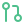

# Hi there, I'm Yufan

 

---

##  关于我 · About Me

人工智能专业在读，平时主要做全栈开发，前端后端都写。

<i>AI student. I mostly do full-stack development, front end and back end.</i>

-  后端常用 Go、Python、Rust，前端用 Vue 和 React
   <i>Go, Python and Rust on the back end; Vue and React on the front end.</i>
-  给 **[Apache TVM](https://github.com/apache/tvm)** 和 **[kornia](https://github.com/kornia/kornia)** 提过 5 个 PR，都已合并
   <i>5 merged PRs to Apache TVM and kornia.</i>
-  自己的项目有 **[alcedo](https://github.com/hiyufan/alcedo)**（Rust 视频解析库）和 **[拾帧](https://ynvan.com)**（在线视频提取，已上线）
   <i>Side projects: alcedo, a video parsing library in Rust, and ynvan.com, a live video download site.</i>
-  最近在学 LLM 推理和 RAG
   <i>Currently learning LLM inference and RAG.</i>
-  邮箱 **[hi@oiya.net](mailto:hi@oiya.net)**
   <i>Email: hi@oiya.net</i>

---

##  开源贡献 · Open Source Contributions

> 给自己在用的项目提交的上游修复 —— **5 个 PR，全部合并**。
>  <i>Fixes sent upstream to projects I actually use — 5 PRs, all merged.</i>

###  [Apache TVM](https://github.com/apache/tvm) &nbsp;&nbsp; 深度学习编译器 <i>· deep learning compiler</i>

| PR | 状态 | 修复内容 · What it fixes |
|:--|:--|:--|
| [**#20255**](https://github.com/apache/tvm/pull/20255) |  | Relax 的 `reshape` 把字面 `0` 读作"沿用输入维度"（ONNX 语义），PyTorch 却表示真实的零维，导致空张量上的 `reshape` / `view` / `flatten` / `unflatten` 报错或**静默给出错误形状**。与 torch 逐例对照验证 2132 组静态 + 938 组动态形状，并顺带修掉 `RemoveRedundantReshape` 里的同源缺陷。 <i>Relax read a literal <code>0</code> as "copy this dim" where PyTorch means a real zero-sized dim, so empty-tensor reshapes raised or silently returned the wrong shape. Verified against torch on 2,132 static + 938 dynamic shapes; also fixed the same bug in <code>RemoveRedundantReshape</code>.</i> |
| [**#20254**](https://github.com/apache/tvm/pull/20254) |  | `torch.sort` / `argsort` 发出 int32 索引，而其他所有索引类算子都是 int64 —— 一张图里出现两种索引 dtype。 <i><code>torch.sort</code> / <code>argsort</code> emitted int32 indices while every other index op was int64 — one graph, two index dtypes.</i> |
| [**#20245**](https://github.com/apache/tvm/pull/20245) |  | `flatten` 不校验维度，越界的负 `start_dim` 不在调用处报错，而是在下游生成错误的 `reshape`。 <i><code>flatten</code> didn't validate dims, so a bad negative <code>start_dim</code> produced a broken <code>reshape</code> downstream instead of failing at the call site.</i> |

###  [kornia](https://github.com/kornia/kornia) &nbsp;&nbsp; 可微分计算机视觉 <i>· differentiable computer vision</i>

| PR | 状态 | 修复内容 · What it fixes |
|:--|:--|:--|
| [**#4140**](https://github.com/kornia/kornia/pull/4140) |  | 零尺寸的 `resize` / `rescale` 抛 `ZeroDivisionError`，而 warp 类算子对同样参数返回空图像。现在与之对齐，并让空结果留在自动微分图上。经 512 组形状 / 精度 / 插值模式验证对合法输入零影响。 <i>Zero-size <code>resize</code> / <code>rescale</code> threw <code>ZeroDivisionError</code> where the warping ops return an empty image. Now aligned, with the result kept on the autograd graph. Verified inert across 512 combinations.</i> |
| [**#4143**](https://github.com/kornia/kornia/pull/4143) |  | `__all__` 列出了未绑定的名字，`from kornia.core import *` 直接崩溃。恢复绑定，并加了一条全仓库的导出名解析检查。 <i><code>__all__</code> listed unbound names, so <code>import *</code> crashed. Restored them and added a repo-wide check that every exported name resolves.</i> |

---

##  项目 · Featured Projects

| 项目 | 说明 · Description | 技术栈 |
|:--|:--|:--|
|  [**alcedo**](https://github.com/hiyufan/alcedo) | 高性能视频平台解析核心，35 个平台，纯 Rust 零外部进程依赖 <i>High-performance video parsing core for 35 platforms — pure Rust, zero external processes.</i> | `Rust` |
|  [**拾帧**](https://ynvan.com) | 抖音 / 小红书 / X 等平台视频图片在线提取，一键转 GIF 和实况照片 <i>Grab videos and images from Douyin, Xiaohongshu, X and more; one-click GIF and Live Photo export.</i> | `Python` `FastAPI` `Docker` |
|  **yf-quant**  | 基于 Qlib 的美股量化研究平台 <i>US equities quant research platform built on Qlib.</i> | `Python` `Qlib` |
|  [**edubridge**](https://github.com/hiyufan/edubridge) | 高校教务系统中间件 <i>Middleware for university academic systems.</i> | `Go` `Vue` |

---

##  正在学 · Currently Learning

<table>
<tr>
<td width="50%" valign="top">

 **RAG · 检索增强生成**
 分块与召回策略、重排序、评测方法
 <i>Chunking & retrieval, reranking, evaluation</i>

</td>
<td width="50%" valign="top">

 **LLM 推理引擎**
 vLLM / SGLang 的调度与显存管理
 <i>Scheduling & KV-cache management in vLLM / SGLang</i>

</td>
</tr>
</table>

---

##  数据 · GitHub Stats

###  贡献图 · Contribution Graph

<picture>
  <source media="(prefers-color-scheme: dark)" srcset="https://raw.githubusercontent.com/hiyufan/hiyufan/output/github-snake-dark.svg" />
  <source media="(prefers-color-scheme: light)" srcset="https://raw.githubusercontent.com/hiyufan/hiyufan/output/github-snake.svg" />
  
</picture>

---

###  联系 · Let's Connect

欢迎交流全栈开发、AI 和开源。 
<i>Happy to chat about full-stack dev, AI, and open source.</i>

