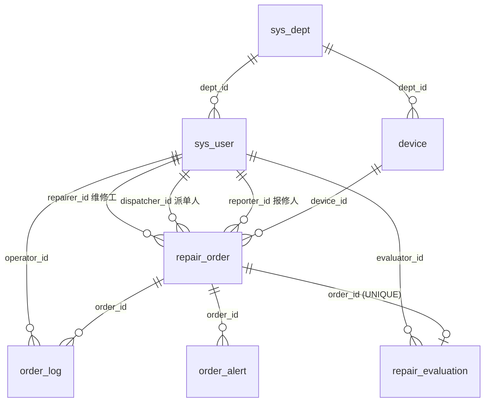

# 数据库设计文档

- 数据库：`cyf_jxrepair`（MySQL 8.0，字符集 `utf8mb4`，引擎 InnoDB）
- 建表脚本：`sql/01_schema.sql`；测试数据：`sql/02_seed.sql`
- 初始化：`cd backend && python scripts/init_db.py --force`

## 1. 表清单

| # | 表名 | 中文名 | 类型 | 说明 |
|---|---|---|---|---|
| 1 | `sys_user` | 用户表 | 核心 | 4 种角色，密码只存 PBKDF2 哈希 |
| 2 | `device` | 设备台账表 | 核心 | 设备编号唯一，有状态（正常/维修中/已报废） |
| 3 | `repair_order` | 报修工单表 | 核心 | 只存外键，不冗余设备名称与人员姓名 |
| 4 | `order_log` | 工单流转日志表 | 核心 | 每次状态变化一条，记录操作人、时间、内容 |
| 5 | `repair_evaluation` | 维修评价表 | 核心 | 一张工单最多一条评价（唯一约束） |
| 6 | `sys_dept` | 部门表 | 支撑 | 用户、设备通过外键归属部门，部门决定厂区 |
| 7 | `fault_knowledge` | 故障知识库 | 支撑 | 离线故障诊断的关键词规则 |
| 8 | `order_alert` | 超期预警表 | 支撑 | 定时任务扫描写入，处理后标记 |

## 2. 表关系

- 工单表通过 `device_id`、`reporter_id`、`dispatcher_id`、`repairer_id` 四个外键关联，界面上的设备名称、人员姓名都通过关联查询获得。修改人员姓名或设备名称后，历史工单自动显示新值，不存在数据不一致。
- 日志、评价、预警都设置了 `ON DELETE CASCADE`：删除工单时一并清理，不留孤儿数据。
- 厂区只存在 `sys_dept.factory_area` 一处。设备和用户都通过部门间接得到厂区，避免同一事实存两份。

## 3. 字段说明

### 3.1 sys_user 用户表

| 字段 | 类型 | 约束 | 说明 |
|---|---|---|---|
| id | INT UNSIGNED | PK, 自增 | 主键 |
| username | VARCHAR(30) | UNIQUE, NOT NULL | 登录账号 |
| password_hash | VARCHAR(128) | NOT NULL | `pbkdf2_sha256$迭代次数$盐$哈希`，不存明文 |
| real_name | VARCHAR(30) | NOT NULL | 真实姓名 |
| phone | VARCHAR(20) | | 联系电话 |
| role | ENUM | NOT NULL, 默认 EMPLOYEE | EMPLOYEE 普通员工 / DEPT_ADMIN 部门管理员 / DEVICE_ADMIN 设备科管理员 / REPAIRER 维修工 |
| dept_id | INT UNSIGNED | FK → sys_dept.id | 所属部门 |
| skills | VARCHAR(100) | | 维修工擅长方向，逗号分隔，智能派单依据 |
| is_active | TINYINT(1) | 默认 1 | 是否启用 |
| created_at / updated_at | DATETIME | 默认 CURRENT_TIMESTAMP | 创建 / 更新时间（更新时间自动刷新） |

### 3.2 device 设备台账表

| 字段 | 类型 | 约束 | 说明 |
|---|---|---|---|
| id | INT UNSIGNED | PK | 主键 |
| device_code | VARCHAR(30) | UNIQUE | 设备编号，如 CNC-A-001 |
| device_name | VARCHAR(50) | NOT NULL | 设备名称 |
| category | VARCHAR(20) | INDEX | 设备类别（数控机床、注塑设备…） |
| model | VARCHAR(50) | | 规格型号 |
| dept_id | INT UNSIGNED | FK → sys_dept.id | 使用部门 |
| location | VARCHAR(50) | NOT NULL | 安装位置 |
| status | ENUM | 默认 NORMAL | NORMAL 正常 / REPAIRING 维修中 / SCRAPPED 已报废 |
| purchase_date | DATE | | 购置日期 |
| created_at / updated_at | DATETIME | 默认 CURRENT_TIMESTAMP | |

### 3.3 repair_order 报修工单表

| 字段 | 类型 | 约束 | 说明 |
|---|---|---|---|
| id | INT UNSIGNED | PK | 主键 |
| order_no | CHAR(14) | UNIQUE | **工单编号**：`CYF` + `yyyyMMdd` + 3 位当日流水，如 `CYF20261119001` |
| device_id | INT UNSIGNED | FK → device.id | 报修设备 |
| reporter_id | INT UNSIGNED | FK → sys_user.id | 报修人 |
| dispatcher_id | INT UNSIGNED | FK → sys_user.id | 派单人（驳回时记录驳回人） |
| repairer_id | INT UNSIGNED | FK → sys_user.id | 维修工 |
| fault_desc | VARCHAR(500) | NOT NULL | **故障描述** |
| photo_paths | JSON | | **现场照片路径**，相对路径数组，如 `["uploads/202611/xxx.jpg"]`，最多 3 张 |
| urgency | ENUM | 默认 NORMAL | LOW 一般 / NORMAL 较急 / HIGH 紧急 |
| status | ENUM | 默认 PENDING | **工单状态**：PENDING 待派单 / ASSIGNED 待接单 / REPAIRING 维修中 / TO_ACCEPT 待验收 / ARCHIVED 已归档 / REJECTED 已驳回 |
| reject_reason | VARCHAR(200) | | 最近一次驳回意见（全部历史见流转日志） |
| repair_result | VARCHAR(500) | | **处理结果** |
| created_at | DATETIME | 默认 CURRENT_TIMESTAMP | 提交时间 |
| dispatched_at / taken_at / completed_at / archived_at | DATETIME | | 派单 / 接单 / 完工 / 归档时间，用于统计平均处理时长 |
| updated_at | DATETIME | 自动刷新 | 更新时间 |

索引：`uk_order_no`、`idx_order_status_created(status, created_at)`（列表按状态筛选并按时间排序）、`idx_order_reporter`、`idx_order_repairer`、`idx_order_device`。

> 状态比题目给出的 5 种多一个「待接单」。原因是派单和接单是两个动作：派单后、接单前，工单需要一个能区分开的状态，否则"维修工接单"这一步无法体现，也无法统计响应时长。

### 3.4 order_log 工单流转日志表

| 字段 | 类型 | 约束 | 说明 |
|---|---|---|---|
| id | BIGINT UNSIGNED | PK | 主键（日志量最大，用 BIGINT） |
| order_id | INT UNSIGNED | FK → repair_order.id, 级联删除 | 工单 |
| operator_id | INT UNSIGNED | FK → sys_user.id | **操作人** |
| action | ENUM | NOT NULL | **操作内容类型**：SUBMIT 提交 / DISPATCH 派单 / REJECT 驳回 / RESUBMIT 重新提交 / TAKE 接单 / COMPLETE 完工 / ACCEPT 验收通过 / ACCEPT_FAIL 验收不通过 / ARCHIVE 归档 / URGE 超期催办 |
| from_status / to_status | VARCHAR(20) | | 操作前后状态 |
| content | VARCHAR(500) | NOT NULL | 操作说明（如"派单给维修工 杨帆"） |
| created_at | DATETIME | 默认 CURRENT_TIMESTAMP | **操作时间** |

### 3.5 repair_evaluation 维修评价表

| 字段 | 类型 | 约束 | 说明 |
|---|---|---|---|
| id | INT UNSIGNED | PK | 主键 |
| order_id | INT UNSIGNED | FK, UNIQUE | 工单（一单一评） |
| evaluator_id | INT UNSIGNED | FK → sys_user.id | 评价人 |
| score | TINYINT | CHECK 1~5 | 满意度星级 |
| comment | VARCHAR(300) | | 评价内容 |
| created_at | DATETIME | 默认 CURRENT_TIMESTAMP | 评价时间 |

### 3.6 支撑表

- **sys_dept**：`id`、`dept_name`（唯一）、`factory_area`（厂区）、`created_at`
- **fault_knowledge**：`id`、`category`（故障大类，与维修工 skills 对应）、`keywords`（逗号分隔）、`cause`、`suggestion`、`created_at`
- **order_alert**：`id`、`order_id`、`alert_type`（DISPATCH_TIMEOUT 超时未派单 / REPAIR_TIMEOUT 超时未完工）、`overdue_hours`、`is_handled`、`handled_by`（NULL 表示系统自动解除）、`handle_note`、`created_at`、`handled_at`

## 4. 测试数据说明

由脚本生成，保证数据前后一致：日志顺序、时间戳先后、评价都与工单状态匹配，同一设备同一时间只有一张处理中的工单。

| 数据 | 数量 | 说明 |
|---|---|---|
| 部门 | 5 | 生产一部(A)、生产二部(B)、注塑车间(C)、仓储物流部(D)、设备科(A) |
| 用户 | 13 | 设备科管理员 2、部门管理员 2、普通员工 5、维修工 4；初始密码均为 `123456` |
| 设备 | 16 | 覆盖 9 个类别、4 个厂区，含 1 台已报废设备 |
| 工单 | 38 | 2026 年 6 月 ~ 11 月；已归档 26、待验收 3、维修中 2、待接单 2、待派单 3、已驳回 2；含 1 张"验收不通过 → 返修 → 归档"的完整案例 |
| 流转日志 | 187 | |
| 评价 | 26 | 3~5 星 |
| 故障知识库 | 19 | 6 个故障大类 |

演示账号：

| 角色 | 账号 | 姓名 | 部门 |
|---|---|---|---|
| 设备科管理员 | sbk01 / sbk02 | 王建国 / 李晓峰 | 设备科 |
| 部门管理员 | dept01 / dept02 | 陈立华 / 周敏 | 生产一部 / 生产二部 |
| 普通员工 | emp01 ~ emp05 | 林志强、黄雅婷、郑凯、吴思琪、许俊 | 各生产部门 |
| 维修工 | wx01 ~ wx04 | 张国庆、刘德明、杨帆、何振宇 | 设备科 |
