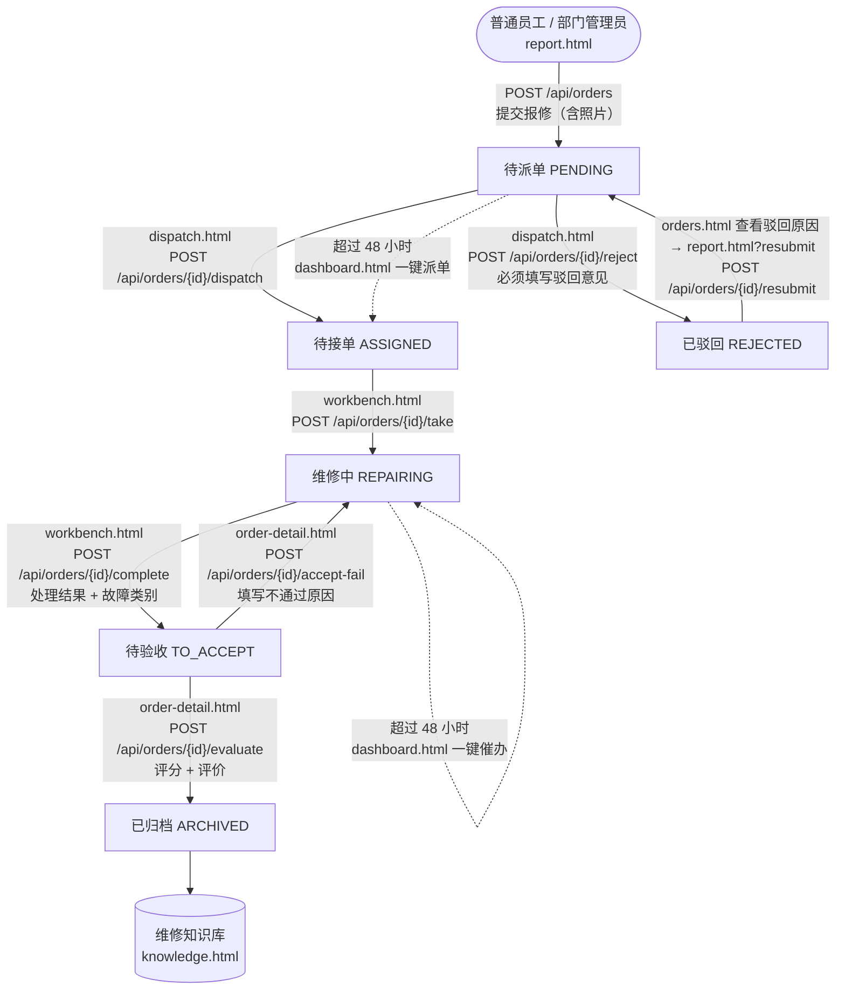

# 需求分析与业务流程

## 1. 委托需求要点

闽榕智造科技有限公司有 300 余名员工、4 个厂区（A~D）。设备报修现在依赖纸质单据和电话，存在三个问题：

| 现状问题 | 系统对应的解决方式 |
|---|---|
| 报修信息遗漏 | 结构化报修表单：设备从台账中选，故障描述与现场照片必填或可选；描述过于简单时设备科可驳回并写明原因 |
| 维修进度不透明 | 工单状态机 + 流转日志：每一步谁在什么时间做了什么都有记录，报修人随时可查进度 |
| 维修数据无法沉淀 | 归档工单自动进入维修知识库；统计看板汇总工单量、处理时长、故障排行；完工时确认的故障类别成为诊断案例 |

## 2. 功能需求清单

共 18 项。题目要求覆盖的 5 类能力已在"能力分类"列标出。

| # | 功能 | 能力分类 | 类型 | 说明 |
|---|---|---|---|---|
| 1 | 登录与角色识别 | 用户与角色权限 | 基础必做 | 账号密码登录，按 4 种角色进入不同首页 |
| 2 | 登录状态保持与退出 | 用户与角色权限 | 基础必做 | token 本地保存，刷新不掉线；退出清除登录状态 |
| 3 | 角色权限隔离 | 用户与角色权限 | 基础必做 | 页面、按钮、数据三层隔离，后端拦截一切越权操作 |
| 4 | 用户管理 | 用户与角色权限 | 基础必做 | 新增、编辑、启停、重置密码；部门管理员仅管本部门员工 |
| 5 | 设备台账管理 | 报修提交 | 基础必做 | 设备增删改查，报修时从台账选择设备 |
| 6 | 报修提交（含照片） | 报修提交 | 基础必做 | 选择设备、描述故障、紧急程度、最多 3 张 jpg/png 照片 |
| 7 | 工单列表 | 工单流转 | 基础必做 | 分页、状态筛选、关键词检索，按角色限定数据范围 |
| 8 | 工单详情与流转日志 | 工单流转 | 基础必做 | 维修单式展示，完整操作记录 |
| 9 | 派单 | 工单流转 | 基础必做 | 设备科选择维修工派单 |
| 10 | 驳回与重新提交 | 工单流转 | 基础必做 | 设备科填写驳回意见，员工修改后重新提交 |
| 11 | 接单与完工提交 | 工单流转 | 基础必做 | 维修工接单、填写处理结果并确认故障类别 |
| 12 | 验收评价与归档 | 验收评价 | 基础必做 | 报修人 1-5 星评价，通过即归档；不通过退回返修 |
| 13 | 统计看板 | 统计看板 | 基础必做 | 月度工单量、状态分布、平均处理时长、设备故障排行 |
| 14 | 故障智能诊断 | 报修提交 / 工单流转 | 加分拓展 | 规则 + 历史案例推理，给出可能原因与建议，辅助派单 |
| 15 | 维修知识库检索 | 验收评价（沉淀） | 加分拓展 | 归档工单自动入库，BM25 相似检索 |
| 16 | 工单智能摘要 | 工单流转 / 统计看板 | 加分拓展 | 结构化摘要，用于派单页与看板 |
| 17 | 超期工单预警 | 统计看板 | 加分拓展 | 定时扫描超 48 小时未派单 / 未完工的工单，可一键处理 |
| 18 | 智能派单推荐 | 工单流转 | 加分拓展 | 按擅长方向、负载、同类经验、满意度综合打分推荐维修工 |

## 3. 报修业务全流程

| 环节 | 操作人 | 页面 | 接口 | 状态变化 |
|---|---|---|---|---|
| 提交报修 | 普通员工 / 部门管理员 | `report.html` | `POST /api/orders` | — → 待派单 |
| 派单 | 设备科管理员 | `dispatch.html` | `POST /api/orders/{id}/dispatch` | 待派单 → 待接单 |
| 驳回 | 设备科管理员 | `dispatch.html` | `POST /api/orders/{id}/reject` | 待派单 → 已驳回 |
| 重新提交 | 报修人本人 | `orders.html` → `report.html?resubmit=id` | `POST /api/orders/{id}/resubmit` | 已驳回 → 待派单 |
| 接单 | 被指派的维修工 | `workbench.html` | `POST /api/orders/{id}/take` | 待接单 → 维修中 |
| 完工提交 | 被指派的维修工 | `workbench.html` | `POST /api/orders/{id}/complete` | 维修中 → 待验收 |
| 验收评价 | 报修人本人 | `order-detail.html` | `POST /api/orders/{id}/evaluate` | 待验收 → 已归档 |
| 验收不通过 | 报修人本人 | `order-detail.html` | `POST /api/orders/{id}/accept-fail` | 待验收 → 维修中 |

所有流转规则集中在 `backend/app/services/workflow.py` 的 `TRANSITIONS` 表中。已归档是终态，任何操作都会被拒绝。

## 4. 角色权限矩阵

| 能力 | 普通员工 | 部门管理员 | 设备科管理员 | 维修工 |
|---|:-:|:-:|:-:|:-:|
| 提交报修 / 驳回后重提 / 验收评价 | ✓（本人） | ✓（本人） | | |
| 查看工单 | 本人提交的 | 本部门员工提交的 | 全部 | 指派给本人的 |
| 派单 / 驳回 / 处理超期预警 | | | ✓ | |
| 接单 / 完工提交 | | | | ✓（本人） |
| 统计看板 | | 本部门 | 全厂 | |
| 设备台账 | | | ✓ | |
| 人员管理 | | 本部门普通员工 | 全部 | |
| 维修知识库 | ✓ | ✓ | ✓ | ✓ |

越权访问别人的工单返回"工单不存在或无权查看"（404），不暴露工单是否存在。
